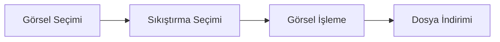

<div align="center">

</div>

Görsel Küçültücü, görsellerin boyutunu ve sıkıştırma seviyesini kolayca ayarlayarak görsellerin boyutunu küçültmek için bir uygulamadır. Uygulama tamamen tarayıcıda çalışır ve görseller hiçbir sunucuya yüklenmez.

<details>
<summary><b>📋 İçindekiler</b></summary>

- [✨ Özellikler](#-özellikler)
- [⚙️ Nasıl Çalışır](#-nasıl-çalışır)
- [📦 Kurulum](#-kurulum)
- [🚀 Kullanım](#-kullanım)
- [🔧 Yapılandırma](#-yapılandırma)
- [📁 Proje Yapısı](#-proje-yapısı)
- [🤝 Katkıda Bulunma](#-katkıda-bulunma)
- [👤 Geliştirici](#-geliştirici)

</details>

## ✨ Özellikler

### 📈 Görsel Boyut Küçültme

- Görsel boyutunu belirtilen oranda küçültür
- Görselin boyutunu belirtilen piksel boyutuna küçültür
- Çözünürlük ve format değiştirmeden görsellerin boyutunu küçültür

### 📉 Görsel Sıkıştırma

- Görseli az önerilen sıkıştırma seviyesinde sıkıştırır
- Görseli belirtilen sıkıştırma oranıyla sıkıştırır
- Sıkıştırma seviyesi seçmek için seçenekler sunar

### 📥 Dosya İşlemleri

- Birden çok görselin dosya boyutunu ve sıkıştırma seviyesini aynı anda değiştirmek
- Küçültülmüş görselleri indirmek
- Uygulamayı temizlemek


## ⚙️ Nasıl Çalışır



1. **Görsel Seçimi** — Kullanıcı görselleri sürükle bırak ya da kutuya tıklayıp seçer
2. **Sıkıştırma Seçimi** — Kullanıcı sıkıştırma seviyesini seçer
3. **Görsel İşleme** — Uygulama görsellerin boyutunu küçültür ve sıkıştırır
4. **Dosya İndirimi** — Küçültülmüş görselleri kullanıcının belirttiği klasöre kaydeder

| Bileşen | Görev |
| --- | --- |
| `gorsel-kucult.html` | Uygulamanın tamamı, tek dosya, kurulum yok |
| `PROJECT_INFO.md` | Proje bilgileri ve kullanım talimatları |

## 📦 Kurulum

```bash
# Repoyu klonlayın
git clone https://github.com/Burakcnz/gorsel-kucultme.git
cd gorsel-kucultme
```

## 🚀 Kullanım

#### Görselleri Küçültmek

1. Görselleri sürükle bırak ya da kutuya tıklayıp seç
2. Sıkıştırma seviyesini seç
3. Küçült düğmesine tıklayarak görsellerin boyutunu küçült
4. Küçültülmüş görselleri indirmek için İndir düğmesine tıklayın

#### Uygulamayı Temizlemek

1. Uygulamadaki görselleri temizlemek için Temizle düğmesine tıklayın
2. Uygulamayı yenilemek için Yenile düğmesine tıklayın

## 🔧 Yapılandırma

### 📚 Dokümantasyon

Projedeki ayrıntılı rehberler:

- [Görsel Küçültücü — Proje Bilgisi](PROJECT_INFO.md)

## 📁 Proje Yapısı

```text
├── Görsel_Boyut_Küçültme.html
└── PROJECT_INFO.md
```

## 🤝 Katkıda Bulunma

Katkılarınızı bekliyoruz! Şu adımları izleyin:

1. Repoyu fork'layın
2. Yeni bir dal oluşturun (`git checkout -b ozellik/yeni-ozellik`)
3. Değişikliklerinizi commit'leyin (`git commit -m 'Yeni özellik ekle'`)
4. Dalınızı push'layın (`git push origin ozellik/yeni-ozellik`)
5. Bir Pull Request açın

## 👤 Geliştirici

<p align="center">
  <a href="https://github.com/Burakcnz"></a>
  <br />
  <b>Burak Can Zengin</b> · <a href="https://github.com/Burakcnz">@Burakcnz</a>
</p>

<p align="center"><a href="https://github.com/Burakcnz/gorsel-kucultme">⭐ Projeyi beğendiyseniz yıldız vermeyi unutmayın!</a></p>


